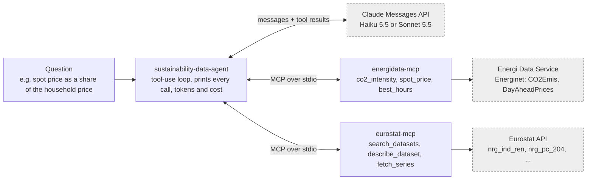

# sustainability-data-agent

A small agent that answers energy questions no single data source can answer, by using two
MCP servers at once: **energidata-mcp** (hourly CO2 intensity and spot prices on the Danish
grid, from Energinet) and **eurostat-mcp** (EU energy statistics). Ask "what share of a Danish
household's electricity price is the spot price?" and it fetches the spot price from one server,
the household price from the other, converts the units and does the sum, printing every tool
call it made.

## The question

Do two separately built MCP servers work together for an agent without changes to either?
Measured on 10 questions that each need both servers, with right answers computed by a plain
script from the same two public APIs, no model involved.

**Score: 10 out of 10** with Claude Haiku 5.5 (0.022 USD for all 10) and **10 out of 10** with
Claude Sonnet 5.5 (0.354 USD), one run each, 2026-11-19.

## How the projects connect

This is the first project that joins the others. The two servers were built and evaluated on
their own (each scored 10/10 on its own questions); here they are used unchanged, pinned to a
fixed commit each, behind one agent.



The full structure, one question step by step and the eval are drawn in
[docs/architecture.md](docs/architecture.md).

## Run it

Needs Python 3.11 or newer and an Anthropic API key. From a clone of this repository:

```bash
python -m venv .venv
.venv/Scripts/pip install -r requirements.txt      # macOS/Linux: .venv/bin/pip
export ANTHROPIC_API_KEY=...                        # PowerShell: $env:ANTHROPIC_API_KEY="..."
.venv/Scripts/python -m sustainability_data_agent "How does Denmark's renewable share compare with the EU average?"
```

On Windows, keep the clone in a short path (for example `C:\code\sustainability-data-agent`)
or turn on long path support: the `anthropic` package has files whose full path inside a venv
passes Windows' 260-character limit when the folder is deep, and pip then stops halfway.

`requirements.txt` installs the two servers from `vendor/` (snapshots of one commit each, see
[vendor/README.md](vendor/README.md)) and this agent. The agent starts both servers itself;
nothing else needs to run. Add `--model claude-sonnet-5-5` for Sonnet; Haiku 5.5 is the default.

Every answer starts with the tool calls. Question q02 of the eval with Haiku 5.5 (shortened):

```text
Tool calls (3):
  1. energidata__spot_price("area"="DK1","start"="2026-11-17","currency"="EUR")
  2. eurostat__describe_dataset("dataset"="nrg_pc_204")
  3. eurostat__fetch_series("dataset"="nrg_pc_204","filters"={"geo"=["DK"],"nrg_cons"=["KWH2500-4999"],"tax"=["I_TAX"],"currency"=["EUR"],"unit"=["KWH"],"siec"=["E7000"],"freq"=["S"]},"since"="2026-S1","until"="2026-S1")
...
ANSWER: {"spot_eur_mwh": 209.17, "household_eur_kwh": 0.2375, "pct": 88.07}
```

The exact calls and answers of every question are in `eval/results/`. A full unscored run,
Denmark against the EU average plus "tomorrow's cleanest hours", is in
[docs/example-run.md](docs/example-run.md).

## Tests

```bash
.venv/Scripts/python -m pytest      # 10 tests, offline: no model, no network
.venv/Scripts/python verify.py      # compile, tests, reference check, both servers over stdio
```

The tests run both real servers in memory and answer their API calls from the raw API answers
saved in `eval/data/`. They check that every one of the 10 right answers can be reached through
the six tools, drive the agent loop with a scripted stand-in for Claude (parallel calls, bad
tool names, a bad date, an unknown dataset, the turn limit, a refusal) and check the spend cap.

## The eval

- `eval/questions.json`: 10 questions, the keys each answer must have, and a tolerance per
  number. Four combine the two sources in one calculation (q02, q03, q04, q07: a spot price as
  a share or multiple of a household price); six put a Danish grid fact next to an EU statistic.
- `eval/reference.py`: computes the right answers with the standard library only. It decodes
  Eurostat's JSON-stat and averages Energinet's 5 and 15 minute rows into hours with its own
  code, so it shares nothing with the servers it checks. Writes `eval/expected.json`.
- `eval/run_eval.py`: asks the agent each question in a fresh conversation (servers shared),
  scores the final `ANSWER: {...}` line, saves answers, tool calls, tokens and cost in
  `eval/results/`, and adds each question's cost to `eval/results/spend.jsonl`. It refuses to
  start when the money already spent plus an estimate for the run would pass `--cap`
  (default 3 USD).

Rule set before the runs: a question is right when every key is present, each number is within
its tolerance (0.01 for percentage points, g/kWh and EUR/MWh; 0.0001 EUR/kWh; 0.1 for
percentages; 0.5 percent relative for the ratio in q04) and each hour, area or country code
matches exactly.

```bash
.venv/Scripts/python eval/reference.py      # uses eval/data/, downloads only what is missing
.venv/Scripts/python eval/run_eval.py       # paid: about 0.02 USD on Haiku 5.5
```

## Results

| # | Question (short) | Right answer (plain script) | Haiku 5.5 | Sonnet 5.5 |
|---|---|---|---|---|
| q01 | DK minus EU27 renewable share 2024; cleanest hour DK1, 18 Nov | 21.22 pp; 18:00 | right (3 calls) | right (2) |
| q02 | DK1 mean spot 17 Nov as % of DK household price 2026-S1, all taxes | 209.17 EUR/MWh, 0.2375 EUR/kWh, 88.07 % | right (3) | right (3) |
| q03 | DK2 mean spot 18 Nov as % of DK household price excl. taxes | 177.57 EUR/MWh, 0.1889 EUR/kWh, 94.00 % | right (4, 1 error) | right (3) |
| q04 | DK household price / cheapest DK1 hour 18 Nov | 04:00; 2.38 times | right (3) | right (3) |
| q05 | Lower-CO2 area 17 Nov; DK renewable share in electricity 2024 | DK2; 79.655 % | right (4) | right (3) |
| q06 | Dearest EU27 household price 2026-S1; dearest DK2 hour 17 Nov | IE; 09:00, 266.97 EUR/MWh | right (3) | right (4, 1 error) |
| q07 | Cheapest 3 h DK1 block 17 Nov as % of EU27 household price | starts 21:00; 59.31 % | right (4, 1 error) | right (3) |
| q08 | DE minus DK household price 2026-S1; DK1 mean CO2 18 Nov | 0.1243 EUR/kWh; 120.92 g/kWh | right (3) | right (3) |
| q09 | DK minus EU27 renewable share in electricity 2024; cleanest 3 h DK1 17 Nov | 32.152 pp; starts 21:00 | right (2) | right (3) |
| q10 | DK renewable share change 2015 to 2024; DK1 minus DK2 CO2 18 Nov | 15.992 pp; -0.55 g/kWh | right (4) | right (4) |

The numbers in brackets are tool calls. Every question used at least one tool from each server.

| Model | Score | Tokens in | Tokens out | Cost | Model requests |
|---|---|---|---|---|---|
| Claude Haiku 5.5 | 10/10 | 169,450 | 10,103 | 0.0220 USD | 31 |
| Claude Sonnet 5.5 | 10/10 | 146,419 | 6,100 | 0.3538 USD | 29 |

Cost is computed from the tokens the API reported and the list prices in
`src/sustainability_data_agent/pricing.py`; it is not read from an invoice. Total spent on
this repository so far, including one unscored demo question: 0.3782 USD
(`eval/results/spend.jsonl`).

## What did not work, or nearly

- **Guessed filter names.** Twice (Haiku, q03 and q07) the model called `fetch_series` with a
  made-up dimension `band` for the household consumption band, got a tool error, called
  `describe_dataset`, found the real dimension `nrg_cons` with code `KWH2500-4999`, and then
  got it right. Once (Sonnet, q06) it put the period both in the filters and in `since`, got a
  tool error and retried without it. The error texts from eurostat-mcp were enough to recover;
  no change was needed, but each costs one extra round trip.
- **The rate limit sets the pace.** Energi Data Service allows very few uncached calls; when a
  question needed a dataset not yet in the server's 5 minute cache, the server waited about a
  minute. q03 to q05 took 59 to 67 s and q10 about 35 s; the other questions 4 to 10 s.
- **Server log lines drowned the report.** Both servers log one INFO line per HTTP request to
  the terminal. The agent now switches INFO logging off in the server processes it starts.
- **"Tomorrow" needs a date.** The model does not know today's date, so the system prompt now
  carries it (Danish time). At 04:00 the next day's CO2 forecast was not published yet, and the
  agent said so instead of guessing ([docs/example-run.md](docs/example-run.md)).

## Limits

- **10 questions, one run per model.** A 10/10 says the two servers deliver the right numbers
  for these questions and both models used them correctly once. It does not say every phrasing
  will work.
- **Fixed past days.** The grid questions use 17 and 18 November 2026 so their answers do not
  move; forecasts are not scored, because a forecast has no fixed answer.
- **Eurostat revises data.** `expected.json` holds the values downloaded on 2026-11-19
  (nrg_ind_ren updated 2026-09-15, nrg_pc_204 updated 2026-10-19). Run
  `eval/reference.py --refresh` before a new paid run; an old score may not reproduce exactly.
- **The questions name their datasets.** Each question names the Eurostat dataset and filter
  (for example `nrg_pc_204`, band DC). Without that, "the household price" has several valid
  readings (band, taxes, half-year), and a right answer could not be fixed in advance.
- **Mixed time frames.** Some questions compare a November 2026 spot price with a 2026-S1
  household price. That is how the data is published; each question says which periods it uses.
- **Spot price only.** Day-ahead prices exclude taxes, tariffs and grid fees; the household
  prices from Eurostat include them unless the question says otherwise.
- **Cost figures depend on list prices** written into `pricing.py` (from the claude-api
  reference, cached 2026-11-03). Check current prices before relying on them.
- **The servers are pinned.** Improvements made to either server after commits `b7a71f7`
  (energidata-mcp) and `7d1aeee` (eurostat-mcp) reach this agent only when the snapshot in
  `vendor/` is replaced and the eval rerun.

## Data sources and credit

- Energinet, [Energi Data Service](https://www.energidataservice.dk/): datasets `CO2Emis`,
  `CO2EmisProg` and `DayAheadPrices`, under CC BY 4.0 per its terms. Source: Energinet. Changes
  made: sub-hourly values averaged into hours. Energinet does not endorse this project.
- Eurostat: datasets `nrg_ind_ren` (share of renewable energy) and `nrg_pc_204` (electricity
  prices for household consumers, bi-annual), reused with acknowledgement per the
  [Eurostat copyright notice](https://ec.europa.eu/eurostat/web/main/help/copyright-notice).
  Eurostat bears no responsibility for this project.
- The raw API answers used for the eval and the offline tests are stored unchanged in
  `eval/data/`.
- Built with the [Anthropic Python SDK](https://github.com/anthropics/anthropic-sdk-python)
  and the [MCP Python SDK](https://py.sdk.modelcontextprotocol.io/) (version 2.3).
