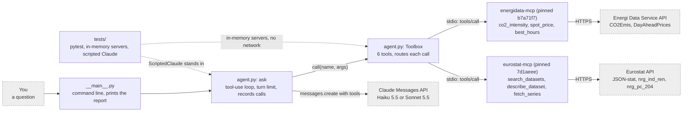
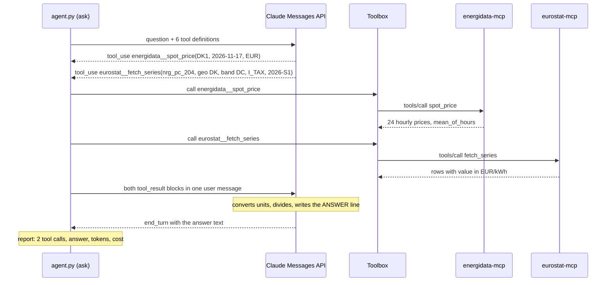
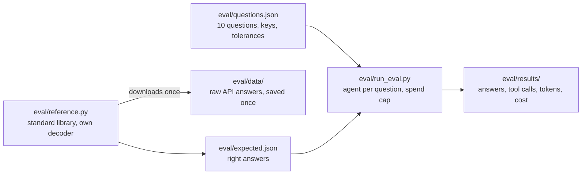

# Architecture

Line numbers point at the main function or class of each box.

## (a) Structure

One Python process. It starts the two MCP servers as child processes (unchanged pinned snapshots in `vendor/`), talks to each over stdio, and calls the Claude Messages API. Dashed arrows are test-only.

| Box | File | Main function or class | What it does |
|---|---|---|---|
| Command line | `src/sustainability_data_agent/__main__.py:19` | `run` | Connects to both servers, asks one question, prints calls, answer, tokens, cost. |
| Tool-use loop | `src/sustainability_data_agent/agent.py:153` | `ask` | Sends question and tools to Claude, runs the tools it asks for, returns all results in one message. Stops at an answer, a refusal or the turn limit (12). |
| Toolbox | `src/sustainability_data_agent/agent.py:105` | `Toolbox` (`connect` at :145) | Names tools `<server>__<tool>`, routes calls. A failing call becomes error text for Claude. |
| Server commands | `src/sustainability_data_agent/agent.py:41` | `server_commands` | Starts each server with the agent's own Python. |
| Claude Messages API | outside this repository | n/a | Chooses tools, does the arithmetic, writes the answer. |
| energidata-mcp | `vendor/energidata-mcp-b7a71f7.tar.gz` | its own `docs/architecture.md` | CO2 intensity and day-ahead prices, DK1 and DK2. |
| eurostat-mcp | `vendor/eurostat-mcp-7d1aeee.tar.gz` | its own `docs/architecture.md` | Search, describe, fetch any Eurostat dataset. |
| Cost | `src/sustainability_data_agent/pricing.py:18` | `cost_usd` | Price per request from reported tokens. |
| Tests | `tests/conftest.py` | `offline` fixture | Real servers in memory, API calls answered from `eval/data/`. |

## (b) One question, two servers

q02: "What percentage of the Danish household electricity price (Eurostat) was the mean DK1 spot price on 17 November 2026 (Energi Data Service)?" Parallel tool calls run in turn; all results go back in one message.

`ask` (`agent.py:153`) calls `messages.create` and keeps the full assistant content, thinking blocks included. `Toolbox.call` (in `Toolbox` at :105) splits `energidata__spot_price` into server and tool and returns the JSON as text. In the eval, `score` (`src/sustainability_data_agent/scoring.py:50`) compares each key of the final `ANSWER: {...}` line with `eval/expected.json` within its tolerance.

## (c) The eval around it

The reference script shares no code with the servers. The offline tests replay `eval/data/` through the real servers and check that every reference answer is reachable (`tests/test_cross_source.py`), so a miss in the paid eval belongs to the model.
