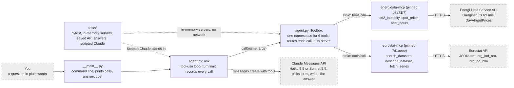
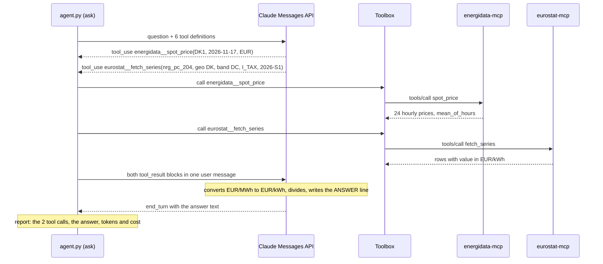
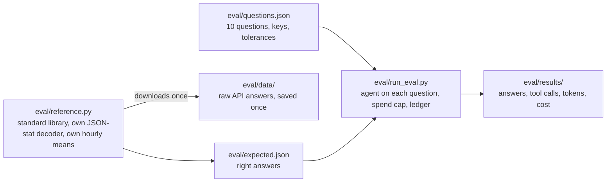

# Architecture

How `sustainability-data-agent` is put together, drawn from the code as it is. Line numbers
point at the main function or class of each box. Both diagrams render on GitHub.

## (a) Structure: who calls whom

The agent is one Python process. It starts the two MCP servers as child processes and talks to
each over stdio, exactly as Claude Code or Claude Desktop would. It also talks to the Claude
Messages API. The servers are not changed here: they are installed from pinned snapshots
(`vendor/`). An arrow reads "uses". Dashed arrows are test-only.

| Box | File | Main function or class | What it does |
|---|---|---|---|
| Command line | `src/sustainability_data_agent/__main__.py:19` | `run` | Connects to both servers, asks one question, prints the report: tool calls, answer, tokens, cost. |
| Tool-use loop | `src/sustainability_data_agent/agent.py:153` | `ask` | Sends the question and the tool list to Claude; while Claude asks for tools, runs them and sends all results back in one message; stops at a final answer, a refusal or the turn limit (12). |
| Toolbox | `src/sustainability_data_agent/agent.py:105` | `Toolbox` (`connect` at :145) | Lists the tools of every connected server, renames them `<server>__<tool>`, and routes each call back to the right server. A failing call becomes an error text for Claude, never a crash. |
| Server commands | `src/sustainability_data_agent/agent.py:41` | `server_commands` | Starts each server with the same Python as the agent, so the pinned packages in the venv are used. |
| Claude Messages API | outside this repository | n/a | Chooses which tools to call with which arguments, does the arithmetic, writes the answer. |
| energidata-mcp | `vendor/energidata-mcp-b7a71f7.tar.gz` | its own `docs/architecture.md` | Hourly CO2 intensity and day-ahead prices for DK1 and DK2. |
| eurostat-mcp | `vendor/eurostat-mcp-7d1aeee.tar.gz` | its own `docs/architecture.md` | Search, describe and fetch any Eurostat dataset. |
| Cost | `src/sustainability_data_agent/pricing.py:18` | `cost_usd` | Price per request from the input and output tokens Claude reports. |
| Tests | `tests/conftest.py` | `offline` fixture | Runs both real servers in memory and answers their API calls from `eval/data/`, the same raw answers the reference script read. |

## (b) One question, two servers

Question q02: "What percentage of the Danish household electricity price (Eurostat) was the
mean DK1 spot price on 17 November 2026 (Energi Data Service)?" The model may call tools in
parallel; the agent runs them one after another and returns all results in one message.

| Step | File | Line | What happens |
|---|---|---|---|
| Request | `src/sustainability_data_agent/agent.py` | `ask` at :153 | `messages.create` with the system prompt, the tool list and the conversation so far. The full assistant content, thinking blocks included, is kept for the next request. |
| Routing | `src/sustainability_data_agent/agent.py` | `Toolbox.call` in `Toolbox` at :105 | Splits `energidata__spot_price` into server and tool, calls it, returns the structured JSON as text. |
| Scoring (eval only) | `src/sustainability_data_agent/scoring.py` | `score` at :50 | Reads the final `ANSWER: {...}` line and compares each key with `eval/expected.json` within its tolerance. |

## (c) The eval around it

The reference script and the servers never share code: the script groups Energi Data Service
rows by the Danish-time hour string and decodes JSON-stat itself. The offline tests replay
`eval/data/` through the real servers and check that every reference answer can be reached
through the tools (`tests/test_cross_source.py`), so a miss in the paid eval belongs to the
model, not the servers.
